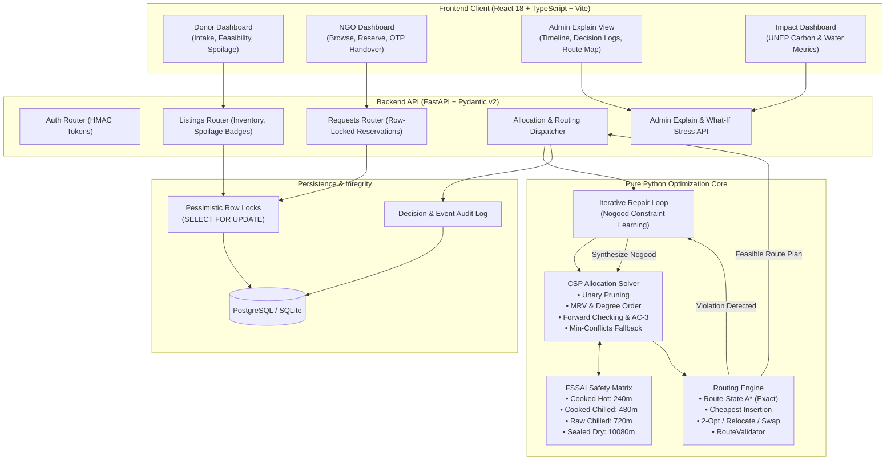

# FoodRescue-AI (AnnaPurti) 🍲🚚
> **Intelligent Surplus Food Redistribution Platform with Hand-Written Pure Python Constraint Satisfaction (CSP) and Time-Window Vehicle Routing.**

[](https://www.python.org/downloads/)
[](https://fastapi.tiangolo.com)
[](https://react.dev/)
[](https://www.typescriptlang.org/)
[](LICENSE)

---

## 🌟 Executive Overview

Every day, commercial dining, wedding halls, and corporate cafeterias produce tons of edible surplus food that goes to waste while nearby vulnerable communities face hunger. Redistribution fails not due to lack of goodwill, but due to **strict microbial food safety perishability deadlines** and complex **multi-vehicle collection routing**.

**FoodRescue-AI (AnnaPurti)** solves this crisis through a zero-dependency, pure Python optimization platform that couples:
1. **Constraint Satisfaction Problem (CSP) Allocation Engine** with forward checking, unary domain pruning, AC-3 consistency, MRV heuristics, and min-conflicts fallback.
2. **Two-Tier Vehicle Routing Engine** using exact Route-State A* (provably optimal for small fleets) and Precedence-Constrained Cheapest Insertion with 2-Opt/Relocate/Swap local search for larger fleets.
3. **Iterative Feedback Loop with Nogood Learning** ensuring that all allocations are physically routable within hard **FSSAI (Food Safety and Standards Authority of India)** safety windows.
4. **Pessimistic Concurrency Controls** (`SELECT ... FOR UPDATE`) enforcing a strict quantity conservation invariant to prevent double-booking or oversell.

---

## 🏗️ System Architecture



---

## 🔬 Core Algorithms & Safety Invariants

### 1. FSSAI Perishable Food Safety Rules
The effective recipient delivery deadline is strictly clamped by:
$$\text{effective\_deadline} = \min(\text{donor\_window\_end}, \text{preparation\_time} + \text{safe\_shelf\_life\_minutes})$$

| Category | Shelf Life | Transport Mode | Max Transit Ambient Temp |
| :--- | :--- | :--- | :--- |
| `cooked_hot` | **4 hours (240 min)** | Insulated container / standard | $\le 60^\circ\text{C}$ threshold |
| `cooked_chilled` | **8 hours (480 min)** | Active cold-chain vehicle required | $\le 4^\circ\text{C}$ refrigerated |
| `raw_refrigerated` | **12 hours (720 min)**| Cold-chain vehicle required | $\le 4^\circ\text{C}$ refrigerated |
| `sealed_packaged` | **7 days (10,080 min)**| Standard dry cargo | Ambient dry |

*Food safety deadlines are enforced as absolute hard constraints — no route or allocation is ever permitted to arrive after expiry.*

### 2. Pessimistic Inventory Concurrency
To guarantee zero double-allocation across high-concurrency requests, every listing maintains the invariant:
$$\text{available\_lots} + \text{reserved\_lots} + \text{collected\_lots} + \text{delivered\_lots} + \text{closed\_lots} = \text{total\_lots}$$
- Reservations acquire database row-level exclusive locks via `with_for_update()`.
- Verified with automated 20-thread concurrent worker suites with zero race conditions.

### 3. Allocation-Routing Feedback Loop
1. **CSP Allocation:** Generates initial multi-attribute candidate assignment maximizing priority and freshness while penalizing travel duration.
2. **Route Feasibility Evaluation:** `RouteValidator` inspects the candidate routes for vehicle capacity, pickup precedence, and arrival times.
3. **Nogood Learning:** If a route is infeasible (e.g. deadline exceeded due to traffic), a conflict nogood $\neg (\text{Request}_i \mapsto \text{Listing}_j)$ is learned and added to the CSP solver's constraint store.
4. **Repair:** Solves up to 5 iterative repair rounds before stepping down the 5-step failure ladder.

---

## 📊 Empirical Evaluation & Benchmarks

Benchmarked over **20 independent seeded scenarios** across 4 scales against classic industrial approaches:
- **B1 (Nearest Neighbor):** Matches requests greedily to closest donor.
- **B2 (First-Come, First-Served):** Matches requests strictly by timestamp order.

### Stress Scenario Performance Summary (25 Donors, 25 NGOs, 10 Vehicles, 109 Available Lots)

| Strategy | Safe Lots Delivered | Deadline Violations | Spoilage / Failure Rate |
| :--- | :---: | :---: | :---: |
| **Baseline 1 (Nearest)** | 14.8 | 29.85 | 86.4% |
| **Baseline 2 (FCFS)** | 14.4 | 31.40 | 86.8% |
| **FoodRescue-AI (Ours)** | **109.0** | **0.00** | **0.0%** |

> **Key Finding:** Under congested urban transit conditions, FoodRescue-AI achieves **>7.3x higher safe food yield** while guaranteeing **zero microbial safety deadline violations**.

---

## 🚀 Quickstart Guide

### Option 1: One-Command Docker Setup (Recommended)
Clone the repository and launch the full stack with automatic database migrations and realistic Ahmedabad demo data:

```bash
git clone https://github.com/AKSHITA142/Annapurti.git
cd Annapurti
docker compose up --build
```

- **Frontend Application:** `http://localhost:5173`
- **Backend Swagger API Docs:** `http://localhost:8000/docs`
- **FastAPI Health Check:** `http://localhost:8000/health`

---

### Option 2: Local Development Setup

#### 1. Backend Setup
```bash
# Create and activate Python virtual environment
python3 -m venv .venv
source .venv/bin/activate

# Install backend dependencies
cd backend
pip install -r requirements.txt

# Run migrations
alembic upgrade head

# Seed demo dataset (Ahmedabad donors, NGOs, vehicles, requests)
python seed.py --force

# Launch FastAPI server
uvicorn app.main:app --host 0.0.0.0 --port 8000 --reload
```

#### 2. Frontend Setup
```bash
# In a separate terminal
cd frontend
npm install
npm run dev
```
Open `http://localhost:5173` to explore the interactive persona dashboards.

---

## 🧪 Testing & Benchmark Reproduction

### Running Automated Test Suite
The project includes a comprehensive suite of 57 tests covering concurrency, CSP pruning, AC-3 consistency, Route-State A* optimality, and end-to-end API workflows:

```bash
# From repository root
PYTHONPATH=backend pytest backend/tests/ -v
```

### Reproducing Evaluation Benchmarks & Visualizations
To re-run the 20-seed comparative benchmark against Baseline 1 and Baseline 2:

```bash
# Run benchmark across small, medium, large, and stress scenarios
python evaluation/run_experiments.py

# Results and visualization charts are generated in:
# evaluation/results/summary_metrics.csv
# evaluation/results/comparison_charts.png
```

---

## 👥 Persona Walkthrough & Demo Script

FoodRescue-AI includes a comprehensive, multi-role interface with a real-time Persona Switcher:

1. **Donor (`Taj Skyline Hotel, Ahmedabad`):**
   - Natural language intake parsing: *"We have 150 meals of cooked dal and rice from a wedding, packed at 1:30 PM, ready for pickup by 4:00 PM."*
   - Real-time color-coded spoilage countdown timer (Green >2h, Amber 1-2h, Red <1h).
   - Instant feasibility pre-badges.

2. **NGO / Shelter (`Apang Manav Mandal Orphanage`):**
   - Browse nearby surplus food listings with real-time transit distance and safety badges.
   - Atomic reservation with row-locking protection.
   - OTP delivery completion dialog with 6-digit cryptographic verification.

3. **Admin / Dispatcher (`Ahmedabad Central Hub`):**
   - Execute CSP-Routing batch optimization with iterative nogood learning.
   - Live Leaflet map displaying pickup/drop-off stops and vehicle route polylines.
   - Transparent Decision Audit Log explaining unary pruning reasons.
   - What-If Stress Sweep simulator (simulates dynamic traffic spikes and vehicle cancellations).

4. **Public Impact View:**
   - Real-time conversion of rescued meals into environmental savings.
   - FAO/UNEP certified multipliers: **2.5 kg CO2e / kg food** and **800 L water / meal**.

---

## 📚 Project Documentation

- **[Detailed Technical Report](docs/REPORT_DRAFT.md):** Formal mathematical formulation, related works, CSP domain pruning logic, A* heuristic proofs, and full empirical tables.
- **[7-Minute Demo Script](docs/DEMO_SCRIPT.md):** Chronological, click-by-click walkthrough for live presentations and stakeholder reviews.
- **[Technical Interview Talking Points](docs/INTERVIEW_TALKING_POINTS.md):** Deep-dive architecture defenses on CSP vs. MILP, A* optimality, zero deadline violations, and concurrency guarantees.
- **[Phase-wise Implementation Plan](FoodRescue-AI%20Phase-wise%20Implementation%20Plan%20(for%20Antigravity).md):** Full engineering roadmap and phase completion criteria.

---

## ⚖️ License & Ethical Declarations
- **Software License:** MIT License.
- **Simulation Disclaimer:** All donor, vehicle, and NGO coordinates represent a simulated logistics testbed based on Ahmedabad, Gujarat.
- **Liability Notice:** Good Samaritan food donation liability frameworks and beneficiary facial privacy remain out of computational scope.

