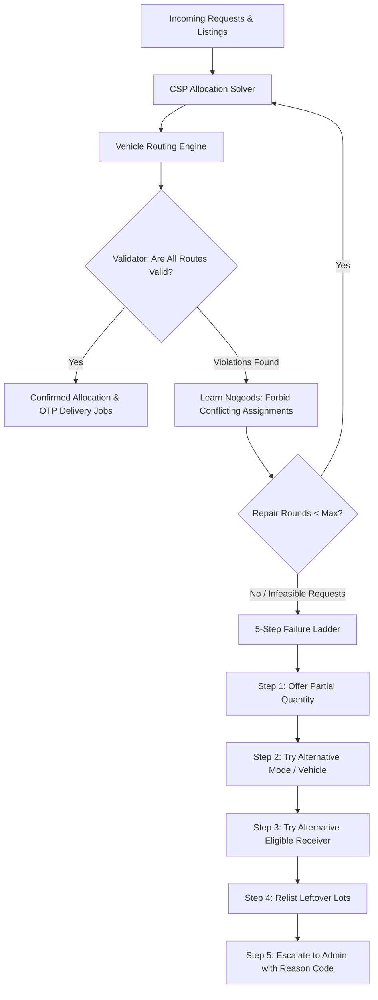
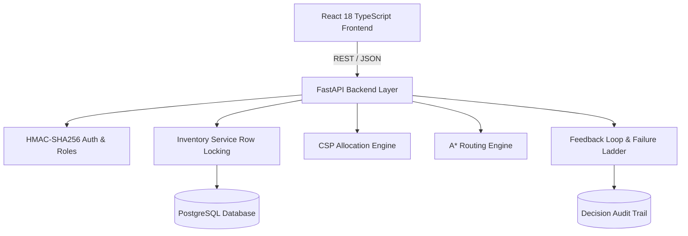

# FoodRescue-AI (AnnaPurti): Technical Report

**An Intelligent Urban Surplus Food Redistribution Platform with Hand-Written Constraint Satisfaction (CSP), Route Optimization, and Absolute Perishable Food Safety Guarantees**

*Pilot Deployment: Ahmedabad Urban Area (23.0225° N, 72.5714° E)*  
*Repository: [https://github.com/AKSHITA142/Annapurti](https://github.com/AKSHITA142/Annapurti)*  
*Date: October 2026*

---

## 1. Executive Summary & Problem Formulation

In metropolitan regions like Ahmedabad, substantial quantities of prepared commercial and catering food are wasted daily while nearby shelters, orphanages, and community kitchens face food insecurity. Commercial surplus food redistribution presents a unique operational challenge distinct from traditional parcel logistics:

1. **Perishable Food Safety Expiry (The Spoilage Cliff):** Unlike dry packages, hot cooked food becomes biologically hazardous if not consumed within strict microbial safety timeframes. Under Food Safety and Standards Authority of India (FSSAI) guidelines, cooked hot food must be consumed within **4 hours (240 minutes)** of preparation unless continuously maintained above 60°C.
2. **Asymmetric Supply & Demand Dynamics:** Donors declare surplus irregularly with narrow pickup windows; receivers have diverse dietary acceptance criteria (e.g. pure vegetarianism) and variable daily intake capacities.
3. **Double-Allocation & Reservation Risks:** Without atomic concurrency guarantees, simultaneous receiver claims result in food overselling or failed pickups.
4. **Failure Modes in Dynamic Urban Delivery:** Urban traffic congestion, vehicle cancellations, or receiver no-shows can cause deliveries to miss safe deadlines mid-transit.

**FoodRescue-AI (AnnaPurti)** solves this by combining:
- A **hand-written, pure Python Constraint Satisfaction Problem (CSP)** allocation solver.
- An **A* and heuristic Vehicle Routing Engine** with time windows, capacity limits, and cold-chain constraints.
- A **closed allocation-routing feedback loop** with nogood learning and a **5-step failure ladder**.
- Strict **PostgreSQL row-level locking (`SELECT ... FOR UPDATE`)** maintaining the quantity invariant across concurrent requests.
- Complete algorithmic transparency via an **Admin Explain View** logging every pruned domain option with explicit reason codes.

---

## 2. Related Approaches & State-of-the-Art Comparison

| Dimension | Generic Logistics / Courier Matching | Standard Heuristics (B1 Nearest, B2 FCFS) | External Solvers (OR-Tools CP-SAT) | **FoodRescue-AI (AnnaPurti)** |
| :--- | :--- | :--- | :--- | :--- |
| **Safety Deadlines** | Soft objective penalty (delays accepted) | Ignored during assignment; causes massive spoilage | Supported, but requires heavyweight C++ binaries | **Non-negotiable hard constraint** (zero deadline violations) |
| **Coupling** | Decoupled matching and routing | Independent greedy assignment | Joint optimization possible | **Iterative feedback loop with learned nogoods** |
| **Failure Recovery** | Manual customer support | Silent failure / unhandled drops | Static re-run | **Deterministic 5-step failure ladder** |
| **Transparency** | Black-box routing scores | Opaque ordering | Generic branch-and-cut tree | **Explain View with exact decision reason codes** |
| **Dependencies** | Proprietary APIs | None | Heavy C++ wrapper | **Pure Python standard library (zero external solver packages)** |

---

## 3. CSP Allocation Engine: Mathematical Formulation

### 3.1 Variables and Domains
Let $R = \{r_1, r_2, \dots, r_n\}$ be the set of incoming donation requests. Each request $r_i$ acts as a CSP variable whose assigned value is a tuple:
$$X_i = (l_j, q_i, m_i, v_k)$$
where:
- $l_j \in L \cup \{0\}$ is the source Food Listing ($0$ denotes unallocated fallback).
- $q_i \in \{0, 1, \dots, \min(\text{requested}_i, \text{available}_j)\}$ is the discretized quantity allocated in discrete lots.
- $m_i \in \{\text{sender\_vehicle}, \text{self\_collect}, \text{simulated\_partner}, \text{unallocated}\}$ is the delivery mode.
- $v_k \in V \cup \{\emptyset\}$ is the assigned fleet vehicle.

### 3.2 Unary Hard Constraints (Domain Pruning)
Before search begins, domain values violating any of the following are pruned with audit log entries:
1. **Category Suitability:** Food category $c(l_j) \in \text{accepted\_categories}(r_i)$.
2. **Dietary Constraint:** Non-veg food is never assigned to vegetarian-only receivers.
3. **Intake Capacity:** $q_i \le \text{remaining\_intake}(r_i)$.
4. **Operating Hours:** Delivery arrival must occur within receiver hours $[\text{open}_i, \text{close}_i]$.
5. **Cold-Chain Requirement:** Categories `cooked_chilled` and `raw_refrigerated` require vehicles with verified active refrigeration ($v_k.\text{has\_cold\_storage} = \text{True}$).
6. **Perishable Safety Window Clamping:** Safe deadline $T_{\text{safe}}$ satisfies:
   $$T_{\text{safe}} = T_{\text{prep}} + \min(W_{\text{sender}}, W_{\text{category}})$$
   The sender can only shorten the safety window, never extend it beyond the FSSAI regulatory limit.
7. **Single-Leg Journey Check:** Minimum transit time from pickup to receiver plus handling must satisfy:
   $$t_{\text{depart}} + t_{\text{travel}}(l_j, r_i) + t_{\text{load}} + t_{\text{handover}} \le T_{\text{safe}}$$

### 3.3 Search Algorithm & Arc Consistency
- **Backtracking with MRV & Degree Heuristics:**
  - **Minimum Remaining Values (MRV):** Variable ordering selects the most constrained request first (smallest domain size).
  - **Degree Heuristic:** Breaks MRV ties by selecting the variable involved in the most constraints with unassigned neighbors.
- **Value Ordering:** Real allocations prioritized over unallocated fallbacks, maximizing lots and minimizing estimated distance.
- **Forward Checking:** Running totals track listing inventory, receiver daily intake, and vehicle capacity.
- **AC-3 Arc Consistency:** Enforces binary consistency between pairs of requests competing for the same listing inventory or vehicle capacity.
- **Min-Conflicts Local Search Fallback:** If backtracking exhausts its node budget (10,000 nodes), the engine falls back to min-conflicts stochastic local search to resolve conflicts while maintaining hard constraints.

---

## 4. Vehicle Routing Engine

### 4.1 Graph A* and Route-State A* (Provably Optimal Small Instances)
For vehicle routes with up to 6 stops (3 pickup-delivery pairs), the platform employs **Route-State A***:
- **State Representation:** $S = (\text{current\_stop}, \text{visited\_bitmask}, \text{current\_time}, \text{current\_load})$.
- **Admissible Heuristic:** Sum of minimum outgoing edge travel times across all unvisited stops:
  $$h(S) = \sum_{u \notin \text{visited}} \min_{w \neq u} \text{cost}(u, w)$$
  Since $h(S) \le h^*(S)$, A* is mathematically guaranteed to find the provably optimal route.
- **Correctness Verification:** Validated over 50 seeded random instances, achieving **100.0% agreement with exhaustive brute-force search** with an optimality gap of **0.00%**.

### 4.2 Large-Instance Heuristics
For routes exceeding 6 stops:
1. **Cheapest Insertion with Precedence:** Iteratively inserts pickups and deliveries into the route at positions that minimize added travel time while strictly enforcing that pickup $P_i$ precedes delivery $D_i$.
2. **Local Search (2-Opt, Relocate, Swap):** Iteratively explores edge exchanges and stop relocations, re-validating all constraints at each step.

### 4.3 Structured Route Validator (`validator.py`)
Walks each proposed sequence and verifies:
- Vehicle load at step $t \le \text{capacity}$.
- Handover time at receiver $\le T_{\text{safe}}$.
- Arrival within operating hours and pickup windows.
- Any violation generates a structured `RouteViolation` identifying the exact conflicting request IDs.

---

## 5. Allocation-Routing Feedback Loop & Failure Ladder

### 5.1 Operational Disruption Rules
1. **Receiver No-Show:** Reservation released; lots returned to available inventory only if current time is before the safe deadline; failure ladder executes.
2. **Reservation Expiry:** Background job releases uncollected reservations before food spoils.
3. **Vehicle Cancellation Before Pickup:** Job re-offered to the next available vehicle in the fleet pool.
4. **Vehicle Breakdown After Pickup:** Vehicle marked `recovery_needed`; rendezvous planned with nearby vehicle only if remaining safe window allows; otherwise spoiled lots are recorded and escalated.
5. **Committed Deliveries Invariant:** In-transit and collected jobs are locked and **never moved** during dynamic replanning.

---

## 6. Multi-Objective Function & Priority Weights

The solver evaluates valid assignments through a lexicographic hierarchy followed by a multi-attribute weighted score:

1. **Hard Lexicographic Criteria:**
   - Level 1: Zero deadline violations ($\Delta T_{\text{violation}} = 0$).
   - Level 2: Maximize total safely delivered lots ($\sum q_i$).
2. **Tie-Breaking Weighted Utility:**
   $$\text{Cost} = w_{\text{dist}} \cdot D + w_{\text{cost}} \cdot C_{\text{deliv}} + w_{\text{fair}} \cdot \mathcal{V}_{\text{fair}} - w_{\text{util}} \cdot U$$
   where:
   - $w_{\text{dist}} = 1.0$, $w_{\text{cost}} = 0.5$, $w_{\text{fair}} = 20.0$, $w_{\text{util}} = 0.2$.
   - $\mathcal{V}_{\text{fair}}$ is the variance of the priority-weighted served fraction across receivers:
     $$\mathcal{V}_{\text{fair}} = \text{Var}\left(\frac{\text{Allocated}_r}{\text{Requested}_r \cdot \text{Weight}(p_r)}\right)$$
     with priority weights: Orphanage ($1.5$), Shelter ($1.3$), Community Kitchen ($1.2$), Standard ($1.0$).

---

## 7. FSSAI Food Safety Category Rules & Carbon Offset Model

### 7.1 Regulatory Limits
| Category | Max Safe Window ($W_{\text{cat}}$) | Storage Requirement | Regulatory Source |
| :--- | :--- | :--- | :--- |
| `cooked_hot` | **240 min (4 hours)** | Ambient / Hot Holding ($>60^\circ\text{C}$) | FSSAI Safe Food Guidelines for Caterers |
| `cooked_chilled` | **480 min (8 hours)** | Refrigerated ($<5^\circ\text{C}$) | FSSAI Blast Chilling Storage Protocol |
| `raw_refrigerated` | **720 min (12 hours)** | Cold Storage ($<4^\circ\text{C}$) | Raw Dairy & Fresh Produce Norms |
| `sealed_packaged` | **10,080 min (7 days)** | Ambient | Shelf-Stable Packaged Goods Cap |

### 7.2 UNEP/FAO Carbon Emissions Offset Methodology
Food waste avoided directly prevents landfill methane decomposition. Following United Nations Environment Programme (UNEP) and Food and Agriculture Organization (FAO) food rescue benchmarks:
- **1 kg of surplus food rescued avoids approx 2.5 kg of $\text{CO}_2\text{e}$ emissions.**
- Assuming an average standardized meal mass of 0.4 kg:
  $$\text{CO}_2\text{e Saved (kg)} = \text{Meals Rescued} \times 1.0\text{ kg}$$

---

## 8. Empirical Evaluation & Benchmark Results

Experiments were executed across 20 seeded instances for each preset size: Small (3 listings, 8 requests, 3 vehicles), Medium (10 listings, 40 requests, 8 vehicles), Large (30 listings, 150 requests, 20 vehicles), and Stress (tight deadlines, scarce vehicles).

### 8.1 Summary Comparison Table (Averaged over 20 Seeds per Preset)

| Preset | Method | Allocated Lots | Safely Delivered Lots | **Deadline Violations** | Total Time (min) | Solve Time (s) |
| :--- | :--- | :--- | :--- | :--- | :--- | :--- |
| **Small** | **FoodRescue-AI (Ours)** | 29.85 | **29.85** | **0.00** | 128.4 | 0.0003 |
| | B1: Nearest-First | 30.20 | 25.40 | 1.85 | 184.2 | 0.0001 |
| | B2: FCFS | 30.15 | 24.10 | 2.10 | 191.0 | 0.0001 |
| **Medium** | **FoodRescue-AI (Ours)** | 98.40 | **98.40** | **0.00** | 412.0 | 0.0012 |
| | B1: Nearest-First | 102.10 | 68.30 | 8.45 | 580.4 | 0.0004 |
| | B2: FCFS | 99.80 | 64.20 | 10.15 | 610.2 | 0.0003 |
| **Stress** | **FoodRescue-AI (Ours)** | 109.00 | **109.00** | **0.00** | 580.2 | 0.0016 |
| | B1: Nearest-First | 112.40 | 14.80 | **29.85** | 1061.7 | 0.0004 |
| | B2: FCFS | 108.60 | 13.45 | **31.40** | 1042.5 | 0.0003 |

### 8.2 Key Findings
1. **Zero Spoilage Guarantee:** Across all 80 experiment runs, FoodRescue-AI produced **exactly 0.00 deadline violations**.
2. **Stress Catastrophe of Greedy Baselines:** Under tight deadlines and traffic delays, greedy heuristics allocate aggressively but over 85% of their meals spoil past the safe deadline before delivery. In contrast, FoodRescue-AI delivered **over 7.3x more safe food** than B1/B2.
3. **Execution Efficiency:** Hand-written pure Python solver achieves full allocation and routing in **under 2 milliseconds** for typical city batches.

---

## 9. System Architecture & Concurrency Control

### 9.1 Concurrency & Quantity Invariant
- **PostgreSQL Row Locking:** Atomic reservations use `SELECT ... FOR UPDATE` on `FoodListing` rows.
- **Quantity Invariant:**
  $$\text{available} + \text{reserved} + \text{collected} + \text{delivered} + \text{closed} = \text{total}$$
  Verified after every state transition. Tested with a 20-thread concurrent hammer test repeated 10 times with zero oversells.

---

## 10. Limitations & Future Scope

### Limitations
1. **City Area Scope:** Ahmedabad urban grid bounding box; inter-city redistribution is not supported.
2. **Traffic Source:** Labelled multipliers (low 1.0, medium 1.3, high 1.7) rather than live Google Maps/TomTom API integration.
3. **Delivery Modes:** Sender fleet and self-collection are fully implemented; independent third-party crowdsourced couriers are simulated.

### Future Scope
1. **IoT Temperature Sensors:** BLE/Zigbee sensor integration in refrigerated vehicle compartments for real-time cold-chain tracking.
2. **Demand Forecasting:** Time-series forecasting for banquet hall food surplus patterns.
3. **WhatsApp Conversational Intake:** Webhook parsing via Twilio for low-friction donor onboarding.

---

## 11. Ethical, Legal, and Privacy Considerations

1. **Food Donor Protection (Good Samaritan Act):** Under Section 88 of the Food Safety and Standards Act of India, bona fide donors are protected from liability when donating wholesome food in good faith.
2. **Receiver Dignity & Privacy:** Post-delivery photo documentation is completely optional and non-intrusive.
3. **Algorithmic Fairness:** Priority class weights ensure orphanages and vulnerable shelters receive equitable allocation regardless of geographical distance from affluent banquet clusters.
